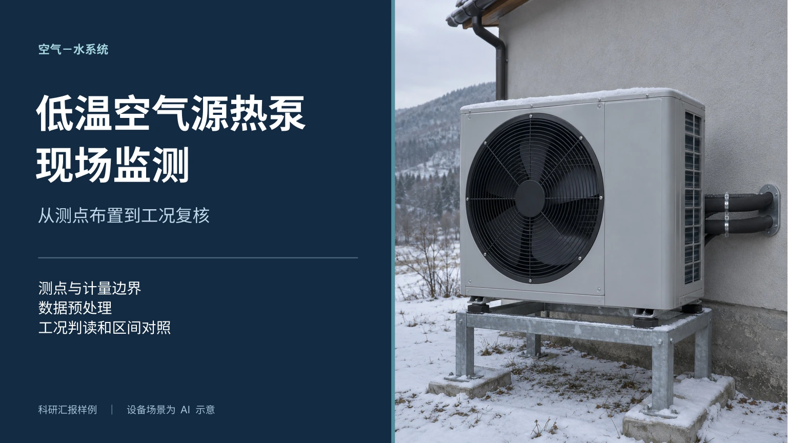

# FrameDeck PPT Studio

把研究资料、会议纪要或项目说明做成可编辑的 PowerPoint。你可以先定逐页文案，再对照视觉稿和可编辑样张，最后导出 PPTX。适合科研汇报、项目答辩和技术分享。

**[下载 Windows 便携版](https://github.com/Chunling1/FrameDeck-PPT-Studio/releases/latest)** · [使用指南](docs/guide.md) · [在 Agent 中使用](skill/ppt-gpt-studio/references/agent-mode.md)

## 科研样例：低温空气源热泵现场监测



五页讲清测点与计量边界、数据预处理、室温下降的事件复核，以及温差和电功率的区间对照。标题、流程图和柱图数据均可编辑。图像为 AI 示意，柱图采用合成数据。

[下载可编辑 PPTX](https://raw.githubusercontent.com/Chunling1/FrameDeck-PPT-Studio/main/docs/examples/heat-pump/heat-pump-monitoring.pptx) · [查看其余四页与参考资料](https://github.com/Chunling1/FrameDeck-PPT-Studio/tree/main/docs/examples/heat-pump)

## 快速开始

1. 从 [Releases](https://github.com/Chunling1/FrameDeck-PPT-Studio/releases/latest) 下载文件名以 `windows-x64.zip` 结尾的便携包并解压。
2. 双击 `launch.cmd`。如果浏览器没有自动打开，访问终端显示的地址。
3. 选择 **打开离线示例**。沿左侧流程做一次逐页策划、打样、审阅和导出。这个示例无需 API Key。

想用自己的资料时，在工作台新建项目，并在「模型设置」配置所选服务的 API Key。也可以通过 [PPT Studio Skill](skill/ppt-gpt-studio/SKILL.md) 让当前对话 Agent 完成模型步骤。能否生图取决于 Agent 是否提供图像工具。

## 导出的文件

| 文件 | 用途 |
| --- | --- |
| `image.pptx` | 投影或分发。每页保留已审阅的整页画面。 |
| `editable.pptx` | 继续修改。文字、流程节点、连线和原生柱状图可编辑，插画是独立可替换的图片。 |
| `project.zip` | 归档或重建。包含来源摘录、审核记录、场景描述和素材。 |

逐页策划可核对原文引用。样张阶段可以对照整页视觉稿与可编辑排版预览，再下载样张到 PowerPoint 检查。锁版前支持单独修改并复审一页。

## 从源码运行

推荐 Python 3.12。仓库已包含构建好的前端。

```powershell
python -m venv .venv
.\.venv\Scripts\python -m pip install -r requirements.txt
.\.venv\Scripts\python studio.py serve --open
```

工作台默认在 `127.0.0.1:8740` 运行。遇到端口占用时，以终端显示的地址为准。命令行也可以直接运行 `python studio.py demo`，它会打印离线示例的导出目录。

## 项目文档

- [使用与开发指南](docs/guide.md)涵盖素材导入、模型配置、文件存放和本地验证。
- [科研构图参考](skill/ppt-gpt-studio/references/research-composition.md)涵盖问题提出、技术路线、证据对照等科研页面。
- [Agent 操作指南](skill/ppt-gpt-studio/references/agent-mode.md)包含无需另配 API Key 的 CLI 工作流与确认步骤。

遇到问题时，欢迎在 [Issues](https://github.com/Chunling1/FrameDeck-PPT-Studio/issues) 附上版本、复现步骤和脱敏报错。代码采用 [MIT 许可](LICENSE)。
