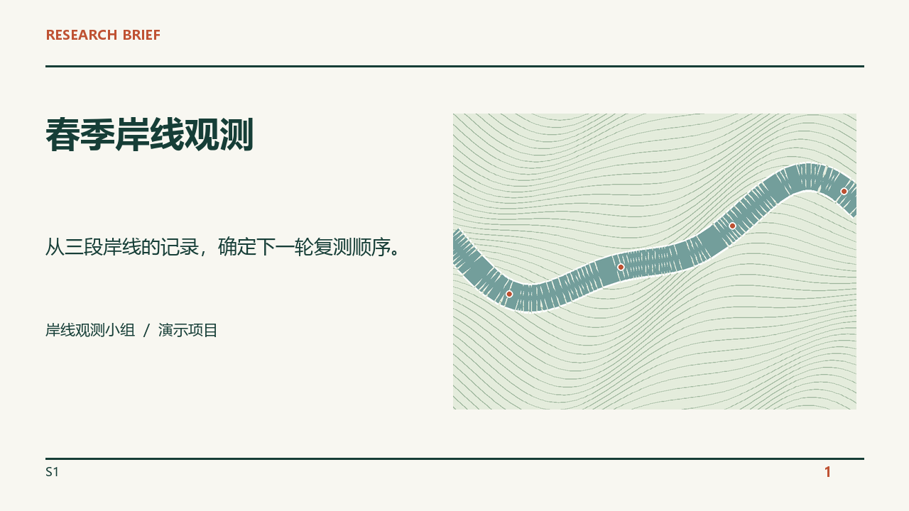

# FrameDeck PPT Studio

**从资料到可编辑 PowerPoint 的本地演示工作台。** 支持科研汇报、项目答辩、工作简报和产品演示。先确定每页要讲什么，再看生成样张和可编辑版本，确认后导出。

## 能做什么

- 根据资料组织逐页标题、主证据和阅读顺序。科研汇报可调用[构图参考](skill/ppt-gpt-studio/references/research-composition.md)来设计方法、证据对照和技术路线页。
- 同时生成整页视觉稿与可编辑样张。PowerPoint 中可修改文字、柱图数据、关系节点和连接线。插画作为独立图片保留。
- 从 CLI 或网页推进项目。按项目方向、逐页方案、样张和全稿四次确认，支持单页返工与交付版本留存。
- 导出图片版 PPTX、可编辑 PPTX 和离线重建工程。可用当前对话 Agent 完成模型步骤，也可自行配置云端 API。

## 开始使用

**Windows x64 便携版**。从 [Releases](https://github.com/Chunling1/FrameDeck-PPT-Studio/releases) 下载 ZIP，解压后双击 **launch.cmd**，点击「打开离线示例」。示例使用合成数据，无需模型配置。

**从源码运行**。推荐 Python 3.12。前端已经构建，可直接使用。

    python -m venv .venv
    .\.venv\Scripts\python -m pip install -r requirements.txt
    .\.venv\Scripts\python studio.py serve --open

运行离线演示也可用命令 python studio.py demo。工作台仅监听回环地址，默认端口为 8740。项目保存在用户目录的 .ppt-gpt-studio，可用 PPT_STUDIO_HOME 指定独立目录。

**通过 Agent 使用**。见 [Skill 入口](skill/ppt-gpt-studio/SKILL.md) 和 [Agent 操作指南](skill/ppt-gpt-studio/references/agent-mode.md)。CLI 的模型任务可由当前 Agent 接手，生图取决于该平台是否具备图像工具。

项目此前叫 PPT-GPT Studio，保留原 CLI、Skill 名称和数据位置。代码采用 MIT 许可，第三方依赖使用各自许可。

## 真实项目

可在工作台右上角“模型设置”填写 API Key 并调整角色，密钥仅在当前服务进程内生效，不写入项目。也可用终端环境变量提供 OPENAI_API_KEY、GEMINI_API_KEY；选择 Claude 时另需 ANTHROPIC_API_KEY。不要把凭证填入资料、项目 JSON 或 Git。

在新建项目中选择“真实模型”，填写受众、主题、预计时长与页数。支持 UTF-8 文本、CSV、DOCX、文字 PDF、PPTX 文本、XLSX 数值和独立图片。嵌入办公文档的照片或论文图请另行导出上传；扫描件先 OCR。单个 20 MB，资料累计十万字。资料会发送到所选云 API，涉及个人或商业机密时请先取得授权。

| 环节 | 人和程序分别做什么 |
| --- | --- |
| 逐页策划 | 策划模型按资料拟写主张、文案、版式、图表数据与原文引证；可反馈重写或手动编辑。 |
| 提示词与校核 | 用户逐页核对构图和原件；审查角色及本地规则检查文字、数字和引文。可以从意见定位到图表和引用表单。未通过不能打样；该审核不证明外部论文真实。 |
| 风格打样 | 封面、信息页、过渡页优先；可只用一家生图服务。配置两家时同页并排盲选，不预选方案。图表和原件按定稿绘制，因此这些页可能相同。 |
| 全稿与锁版 | 审阅发现问题后，可修改单页，保留其他页图片，重新检查本页及全稿一致性。只读查看前面步骤不会回退；明确回退修改才撤销后续批准。 |
| 导出 | image.pptx 每页一张图；editable.pptx 保留文本、柱图及其数据工作簿、可移动节点、连接线、页码字段和独立可替换图片。项目下方保留已交付版本。 |

图片和可编辑稿共享已锁定的场景描述。模型绘制插画区域，权威文案和图表由排版器合成；无需 OCR 猜数字。此版本不对任意外部整页截图做对象逆向识别。流程图、数据图和文字是可编辑的，插画内部不是。图像与原生 Office 图表视觉接近但不保证像素一致。exact 原件按比例完整显示；crop 为允许裁切，当前默认仍保留全图。reference 最多前三张发送给图像服务，exclude 不参与排版。

## 模型与费用

确认逐页稿后，真实项目将由主力模型逐页写视觉设计稿：叙事问题、两种不同构图与取舍、观看顺序、视角和细节、原件/原生层、证据边界、独立生图指令。审查模型同时核查事实和图意。学术风格在逐页策划时读取科研构图参考。生图模型收到画法、粗版面、主视觉叙述、确认稿中的短文案以及配色。详细的证据关系、坐标和可编辑要求留在策划与重建环节。离线示例仍然不调 API。可在项目界面查看实际调用的角色、模型和耗时。

私有网关默认关闭。即使本机有旧配置或旧的 viru 角色环境变量，启动、状态查询和模型预检也不读取旧网关配置或凭证。工作台需要在「模型设置」中点击「使用本机已保存的私有网关」，再在弹窗中确认。授权只在当前工作台进程有效，关闭或重启即恢复关闭。

命令行由用户明确选择并确认后执行：`studio.py --use-private-gateway --confirm-private-gateway step <ID> <操作>`。如需选用另一份网关配置，在 step 前加 `--gateway-profile <配置文件>`。授权仅限该次命令。

如需首次配置，可在确认后运行 `gateway.py <凭证文件> --confirm-private-gateway --install`。这会查询用户选定的网关目录，保存地址、引用路径和已验证的模型名。安装配置不会让后续进程自动启用网关。

提示词校核页的「编辑公共提示词」同时管理各生图页的通用指令和原生页面配色。编译后的指令与原生页面共用一套底色、线色、待决色；不再拼接策划风格色板。保存后在逐页预览核对最终指令并重新校核，打样使用同一版本。

角色环境变量格式为 供应商/模型ID。默认见 providers.py，可按账号权限替换。STUDIO_PLANNER、STUDIO_AUDITOR、STUDIO_CRITIC、STUDIO_ART_OPENAI、STUDIO_ART_GOOGLE。策划与事实校核可以使用同一供应商和同一模型；两步仍分别调用，使用不同指令。真实模式失败会提示错误，不会回退到演示图。模型耗时和 API 返回的用量进入工程记录，不等于账单；用户主动重新生成可能产生新费用。

接口参考：[OpenAI 图像](https://developers.openai.com/api/docs/guides/image-generation)、[Gemini 图像](https://ai.google.dev/gemini-api/docs/image-generation)、[Claude Messages](https://platform.claude.com/docs/en/api/messages/create)。

## 工程与开发

“资料与目标”可直接编辑汇报目标、听众、制作要求及参考原文。可只写要求，不上传文件；此时模型不得虚构事实或数据。本地浏览器自动保留未提交的草稿；“保存输入”写入项目。点“生成逐页策划”会一起提交四项输入和保留的资料。模型步骤会先提示缺少的配置，不请求供应商验证凭证。删除资料仅移除项目内的记录或图片副本，不动用户原文件、既有导出包或已发出的云端请求。

网页模型任务支持刷新后查看进度、暂停与继续。暂停阻止后续调用；已发出的调用会完成并可能计费。暂停状态保留在当前服务进程中，不要在暂停期间重启服务。逐页设计最多两页并行，已完成的设计按内容缓存；不跳过人工确认和提示词校核。

导出的 project.zip 含来源摘录、准确文案、审核记录、原件、锁版场景和图片，属于私有资料。解包后安装 requirements.txt，运行 python rebuild.py 可离线重建两份演示稿；渲染中文需系统安装中文字体，默认微软雅黑。可用 STUDIO_FONT_REGULAR / STUDIO_FONT_BOLD / STUDIO_FONT_FAMILY 指定替代字体。不随包分发商业字体。

模型、状态机、渲染分别在 providers.py、engine.py、render.py；Web 与 CLI 共用。不要同时在 CLI 与网页写同一项目。修改前端后运行 npm ci 和 npm run build。测试运行 python -m unittest discover -s tests。独立 Skill 在 skill/ppt-gpt-studio/，复制到代理的 skills 目录后使用，不覆盖旧 Skill。

Windows 便携构建：在联网 Windows x64 运行 scripts/portable.ps1；它从 python.org 获取签名运行时，从 PyPI 安装 wheel 到独立目录，不复制用户 Python 或 API 密钥。第三方 Python 包许可保留在 dist-info 中。禁止将项目库、密钥、私有样稿或 release 内的个人资料提交到 Git。

## 视觉复验

在“提示词校核台”按页查看完整的插画输入、结构化设计稿和两个模型的固定 JSON 输出契约。配色和风格反馈在打样阶段改变时，预览跟随实际请求更新。校核报告逐项标出页号、字段、严重程度与修改理由。可查看校核建议和已应用改动。无须切换制作方式的字段建议可以应用为新版本。来源、数据和原生文案不自动修改。旧项目的文字建议可以查看，重新校核后才会产生可应用的字段修订。

真实项目从样张阶段就同时提供整页视觉稿、可编辑排版预览和可下载的样张 PPTX。STUDIO_COMPILER 指定的看图模型从样张提取主图区域和原生对象坐标，可按实际构图重新安排图文比例和位置。关系图页保留可编辑的步骤编号、标签断行和对齐、节点描边及连线颜色和线宽。全稿继续逐页核对两版，导出使用通过审阅的布局。工程保存锁定图像及可编辑场景，可用 rebuild.py 离线重建。逐页来源列于页脚，完整原文摘录在演讲者备注。

安装 LibreOffice 及可选 pypdfium2 后，可独立复验：python scripts/native_qa.py 项目目录 对照图输出目录。每页左侧是锁版图，右侧是实际渲染，便于发现字体错位和原生图表差异。此项不能代替 WPS/PowerPoint 编辑实测。

旧版对照评测工具 scripts/blind_eval.py 收取三种题材（科研汇报、领导简报、产品介绍）各三次真实跑稿的 CSV，列名为 genre,run,method,pptx,cost,minutes，method 为 skill 或 studio。prepare 输入.csv 盲评目录 产生匿名稿与打分表；score 私有映射.json 已打分.csv 汇总平均、最差轮次、退稿数、费用和时间。无需真实素材即可开发；没有实测和评分时不会给出“审美已提升”的结论。

## 在对话 Agent 里调用

默认交互模式。项目方向、逐页文案、双版样张、全稿锁版四个节点分别执行 review → 向用户展示 → 等待下一条用户消息 → approve。review 返回材料与版本码；approve 记录真实用户回复。自动化集成必须把确认步骤留给操作者，此机制用于防止流程漏确认，不能认证本地操作者的身份。用户明确说「全自动执行」时，才在 CLI 建项使用 --auto-user-reply 参数。全自动项目同样必须通过成品检查。

逐页方案可为内容页选择 illustration（保留插画）、diagram（生图仅作视觉参考，再按原生节点重建）、native（直接原生排版）。关系图的 diagram.labels 和 diagram.links 在大纲阶段确认。原始整页视觉稿用于图片版，编译器按视觉稿定节点位置，PPTX 用已确认标签和原生连接线输出，裁剪区可以为空。校核对切换制作方式只提建议。逐页或全稿检查失败后，修正相应页再锁版。

## Agent 模式免 API 接入

从对话 Agent 调用 Skill 时，CLI 新项目默认 backend=agent。Studio 将模型任务返回给当前 Agent，以本地 JSON 接收结果。任何需要模型的步骤均可继续使用这条路径，工作台仍可查看项目和文件。纯命令行使用外部模型时选择 new --backend api。现有项目缺少 API Key 时，可在打样之前用 studio.py backend <ID> agent 切换，保留材料和确认。完整命令见 skill/ppt-gpt-studio/references/agent-mode.md。
